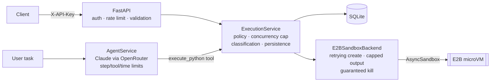

# Agent Sandbox Runner

Secure Python execution for AI agents, built on [E2B](https://e2b.dev) cloud sandboxes.

A FastAPI service that takes untrusted Python, from a developer or from an LLM agent, and runs it inside isolated E2B sandboxes. It manages the whole sandbox lifecycle and returns structured, classified results. A bounded, tool-calling Claude agent uses **the same** execution path, so agent-generated code gets the same policy, limits and audit trail as direct API calls.



## What it does

- **`POST /api/v1/executions`** runs code in a fresh sandbox. It is asynchronous by default (`202` plus a `Location` header); add `?wait=true` to block until the result is ready.
- **`GET /api/v1/executions/{id}`** returns status, stdout/stderr, exit code, duration, sandbox id and error classification.
- **`POST /api/v1/agent/run`** takes a natural-language task. The agent decides whether code is needed, writes it, runs it through the sandbox tool, reads the result and answers. The response includes every execution record, so claims can be checked.
- **`GET /metrics`** reports execution counts by status, p50/p95 duration, live and created sandboxes, average create time, cleanup failures, create retries and agent stop reasons.
- **`GET /health`** is a liveness check. Interactive API docs are at **`/docs`** (OpenAPI).

## Quickstart

```bash
git clone <this repo> && cd agent-sandbox-runner
python -m venv .venv && source .venv/bin/activate   # Windows: .venv\Scripts\activate
pip install -e ".[dev]"
cp .env.example .env    # then set API_KEYS, E2B_API_KEY and (for the agent) LLM_API_KEY
uvicorn app.main:create_app --factory --reload
```

```bash
curl -s -X POST "localhost:8000/api/v1/executions?wait=true" \
  -H "X-API-Key: $API_KEY" -H "Content-Type: application/json" \
  -d '{"code": "print(sum(range(10)))"}'
```

With Docker:

```bash
docker build -t agent-sandbox-runner .
docker run --rm -p 8000:8000 --env-file .env -v asr-data:/data agent-sandbox-runner
```

Then run every outcome end to end: `API_KEY=... python examples/run_examples.py` (add `--agent` to include one agent run).

## Results and error taxonomy

Every execution ends in exactly one terminal status. The core distinction is **"your code failed"** versus **"our infrastructure failed"**:

| status | error_category | meaning | who's at fault |
|---|---|---|---|
| `succeeded` | — | exit code 0 | — |
| `failed` | `user_code_error` | non-zero exit (syntax error, exception, `sys.exit(1)`); `exception_type` is parsed from the traceback | user code |
| `timed_out` | `timeout` | exceeded `timeout_seconds`; partial output kept | user code |
| `error` | `sandbox_unavailable` | sandbox couldn't be created (after retries) | infrastructure |
| `error` | `upstream_error` | sandbox died or the network dropped mid-run | infrastructure |
| `error` | `auth_error` | E2B rejected or is missing credentials | configuration |
| `error` | `interrupted` | server restarted or the agent budget ran out mid-run | infrastructure |
| `error` | `internal_error` | bug in this service | us |

API errors share one envelope: `{"error": {"code", "message", "request_id"}}`. The codes are `unauthorized` (401), `not_found` (404), `invalid_request`, `code_too_large` and `timeout_out_of_range` (422), `rate_limited` (429, with `Retry-After`) and `agent_unavailable` (503).

## Design decisions

The full rationale is in [`docs/design.md`](docs/design.md). The highlights:

- **`commands.run` instead of a notebook kernel.** Each execution writes `/home/user/main.py` and runs `python3` on it, which gives real process semantics and a real exit code. The SDK raises `CommandExitException` for non-zero exits, and we turn that back into a *result*, not an error.
- **Two timeouts.** One per command (the user's limit) and one for the sandbox's lifetime (a backstop). `kill()` always runs in `finally`; if it fails, the lifetime timeout still destroys the VM, and `cleanup_failures_total` records it.
- **Retry creation, never execution.** Sandbox creation is idempotent, so transient failures (rate limit, 503, unreachable, transport) are retried with backoff. Code execution can have side effects, so it never is.
- **Classify carefully.** In the SDK, `SandboxNotRunningException` is a *subclass* of `TimeoutException`. Catching them in the wrong order would report a crashed sandbox as the user's code timing out.
- **Stream output into byte-capped buffers.** A `print` in a loop can't exhaust server memory, and partial output survives timeouts.
- **Concurrency is capped by a semaphore around sandbox sessions.** Excess work waits as `queued` instead of opening more VMs, which keeps cost bounded.
- **The agent can't "claim" success.** Its tool returns the backend's record as JSON. The run result carries `any_execution_succeeded`, computed from stored records rather than model text, and `answer` is `null` unless the run completed.
- **No import blocklists.** They're security theater. Containment is the sandbox's job; this service limits reach (no internet, no secrets) and blast radius (time, output, concurrency). See [`SECURITY.md`](SECURITY.md).

## Configuration

All settings are environment variables; see [`.env.example`](.env.example).

| Variable | Default | Purpose |
|---|---|---|
| `API_KEYS` | — | Comma-separated client keys (`X-API-Key`) |
| `E2B_API_KEY` | — | E2B credentials |
| `SANDBOX_ALLOW_INTERNET` | `false` | Outbound network from sandboxes |
| `MAX_CONCURRENT_SANDBOXES` | `5` | Live sandbox cap (E2B Hobby allows 10) |
| `DEFAULT_TIMEOUT_SECONDS` / `MAX_TIMEOUT_SECONDS` | `30` / `120` | Execution timeouts |
| `MAX_CODE_BYTES` / `MAX_OUTPUT_BYTES` | `100000` / `65536` | Input and output caps (output cap is per stream) |
| `SANDBOX_CREATE_RETRIES` | `3` | Attempts for transient create failures |
| `RATE_LIMIT_PER_MINUTE` | `30` | Per API key |
| `LLM_API_KEY` / `LLM_MODEL` | — / — | OpenRouter key and model (e.g. `anthropic/claude-haiku-5.5`) |
| `AGENT_MAX_STEPS` / `AGENT_MAX_TOOL_CALLS` / `AGENT_TIMEOUT_SECONDS` | `6` / `4` / `180` | Agent bounds |

## Tests

```bash
pytest -q                     # unit tests: no network, no credentials (fake E2B + scripted LLM)
pytest -m integration -q      # live E2B (+ OpenRouter for the agent test); needs .env keys
ruff check . && mypy app      # lint + strict typing
```

Unit tests cover:
- the classification of every outcome
- retry-then-succeed, retries exhausted, and auth errors that must not be retried
- `kill()` on every path, including when `kill()` itself fails
- output capping
- the concurrency cap
- crash recovery
- the auth, rate-limit, ownership and error envelopes
- every agent stop reason: invalid tool arguments, tool-call loops, the step limit, the time limit, and LLM failure

CI (GitHub Actions) runs lint, format, mypy and unit tests on Python 3.11 and 3.12, and builds the Docker image.

## Project layout

```
app/
  api/            executions.py, agents.py, system.py (health, metrics)
  core/           config, JSON logging, metrics, security (owner id, rate limiter)
  sandbox/        base.py (protocol), e2b_backend.py, output.py (capped buffers)
  services/       execution_service.py, agent_service.py
  llm/            base.py (provider protocol), openai_compat.py (OpenRouter)
  schemas/        request/response models
  domain.py       ExecutionRecord, statuses, error categories
  store.py        SQLite persistence
tests/unit/       fast, deterministic
tests/integration/ live E2B / LLM, opt-in
examples/         run_examples.py, requests.http
docs/             design.md, case-study.md
```

## Limitations

These are listed honestly in [`SECURITY.md`](SECURITY.md). In short: isolation is provided by E2B, not this service. Rate limits and metrics are per process. Background executions are in-process, so a restart marks them `interrupted` rather than resuming them. Agent prose is not verified; check it against the execution records.
